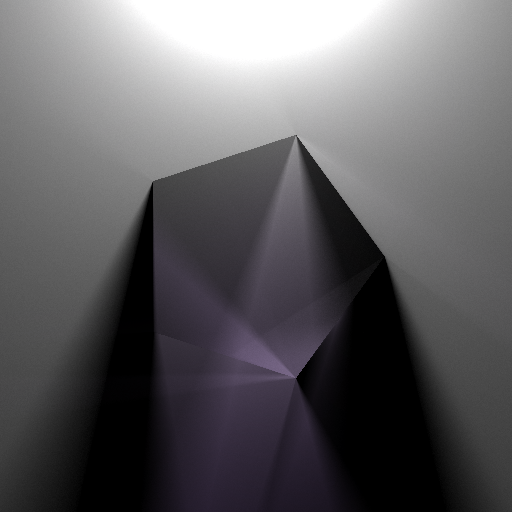

# light2d-rs



## 简介
light2d-rs 是一个用 Rust 编写的 2D 光线追踪渲染器，基于 ***SDF（Signed Distance Field，符号距离场）*** 表达形状，使用 ***Ray Marching（光线步进）*** 进行求交。它支持反射、折射、全内反射、Fresnel 效应、Beer–Lambert 吸收等物理光学现象，并通过 ***JSON 场景文件*** 实现无需重新编译即可自由定义场景。


## 特性

- SDF 形状系统：使用 `Shape` trait + 组合模式（Union / Intersect / Subtract / Complement / Offset），自由构建复杂几何体。
- 物理光学：镜面反射、折射、全内反射、Fresnel 方程、Beer–Lambert 吸收衰减。
- 多重采样抗锯齿：Halton 低差异序列 + 随机偏移，画面干净噪点少。
- 并行渲染：基于 `rayon` 的像素级并行，充分利用多核 CPU。
- JSON 场景描述：形状、材质、环境光均可通过文件配置，无需重新编译。
- 0~255 友好颜色输入：可用直觉的 RGB 值指定发光色与吸收色。
- 可配置环境光：支持 `none` / `constant` / `gradient` 三种模式。
- 预设演示场景：shape / reflect / refraction / beer，开箱即用。

## 快速开始

### 环境要求

- Rust 1.70+（建议使用最新稳定版）
- 支持多核 CPU（渲染加速依赖 rayon）

### 构建

```bash
git clone <repo-url>
cd light2d-rs
cargo build --release
```

### 运行内置场景

```bash
# 啤酒-朗伯演示场景（默认）
cargo run --release -- beer_demo --scene beer --width 800 --height 600 --samples 512

# 反射演示场景
cargo run --release -- reflect_demo --scene reflect --width 800 --height 600 --samples 512

# 折射演示场景
cargo run --release -- refraction_demo --scene refraction --samples 512

# 形状演示场景
cargo run --release -- shape_demo --scene shape --samples 512
```

### 运行自定义 JSON 场景

```bash
cargo run --release -- my_scene --scene-file examples/beer_scene.json --width 800 --height 600 --samples 512
```

### 编译后直接使用二进制s

```bash
./target/release/light2d-rs my_scene --scene-file examples/beer_scene.json --width 1024 --height 768 --samples 1024
```


## 命令行参数

```text
Usage: light2d-rs [OPTIONS] <OUTPUT_NAME>

Arguments:
  <OUTPUT_NAME>                  输出文件名（不含扩展名，作为文件前缀）

Options:
      --width <WIDTH>            图像宽度（默认 512）
      --height <HEIGHT>          图像高度（默认 512）
      --samples <SAMPLES>        每像素采样数（默认 1024）
      --output-dir <DIR>         输出目录（默认 output）
      --scene <SCENE>            预设场景：shape | reflect | refraction | beer（默认 beer）
      --scene-file <FILE>        使用 JSON 场景文件（优先于 --scene）
  -h, --help                     显示帮助
  -V, --version                  显示版本
```

输出文件命名为：`<output-dir>/N<samples>_<output_name>_<timestamp>.png`

## 场景文件格式

场景文件是一个 JSON 文档。推荐的新格式如下（包含可选环境光）：

```json
{
  "ambient": {
    "type": "gradient",
    "top": [0.12, 0.15, 0.25],
    "bottom": [0.02, 0.02, 0.04]
  },
  "shape": {
    "type": "Union",
    "children": [
      {
        "type": "Circle",
        "center": [0.5, 0.5],
        "radius": 0.2,
        "material": {
          "reflectivity": 0.8
        }
      },
      {
        "type": "Box",
        "center": [0.7, 0.3],
        "theta": 0.3927,
        "half_size": [0.1, 0.2],
        "material": {
          "eta": 1.5,
          "absorption_color": [200, 100, 220]
        }
      }
    ]
  }
}
```

***向后兼容***：也支持旧格式（顶层直接是形状节点），此时环境光默认为 `none`。

### 支持的基础形状

| 类型       | 参数                           | 说明                |
| :--------- | :----------------------------- | :------------------ |
| `Circle`   | ``center`, `radius`            | 圆形                |
| `Plane`    | `point`, `normal`              | 半平面              |
| `Ngon`     | `center`, `radius`, `n`        | 正 N 边形           |
| `Capsule`  | `a`, `b`, `radius`             | 胶囊（线段 + 半径） |
| `Box`      | `center`, `theta`, `half_size` | 旋转矩形            |
| `Triangle` | `a`, `b`, `c`                  | 三角形              |

### 支持的组合操作

| 类型         | 参数                | 说明                           |
| :----------- | :------------------ | :----------------------------- |
| `Union`      | `children: [...]`   | 并集（多个子形状合并）         |
| `Intersect`  | `children: [...]`   | 交集                           |
| `Subtract`   | `a`, `b`            | 差集（A 减去 B）               |
| `Complement` | `shape`             | 取反                           |
| `Offset`     | `shape`, `distance` | SDF 偏移（正为膨胀，负为收缩） |

### 材质参数

| 字段               | 类型       | 默认值    | 说明                                      |
| :----------------- | :--------- | :-------- | :---------------------------------------- |
| `reflectivity`     | `f64`      | `0.0`     | 反射率（0~1）                             |
| ``eta`             | `f64`      | `0.0`     | 折射率（>0 时启用透明/折射，如 1.5）      |
| `emissive`         | `[f64; 3]` | `[0,0,0]` | 直接发光强度（HDR）                       |
| `emissive_color`   | `[u8; 3]`  | —         | 0~255 发光色，自动转换为 `emissive`       |
| `absorption`       | `[f64; 3]` | `[0,0,0]` | 吸收系数（用于 Beer–Lambert）             |
| `absorption_color` | `[u8; 3]`  | —         | 0~255 期望透射色，自动转换为 `absorption` |

> 提示：`emissive` 与 `emissive_color` 同时存在时优先使用 `emissive`；`absorption` 与 `absorption_color` 同理。

### 环境光类型

| 类型       | 参数                                | 说明                 |
| :--------- | :---------------------------------- | :------------------- |
| `none`     | —                                   | 纯黑背景（默认）     |
| `constant` | `color: [f64; 3]`                   | 恒定颜色环境光       |
| `gradient` | `top: [f64; 3]`, `bottom: [f64; 3]` | 上下渐变，模拟天空光 |

## 项目结构

```text
light2d-rs/
├── Cargo.toml
├── README.md
├── examples/
│   └── *.json                # 示例场景
└── src/
    ├── main.rs               # 二进制入口
    ├── lib.rs                # 库入口，导出公共 API
    ├── color.rs              # 颜色类型
    ├── vec2.rs               # 二维向量
    ├── ambient.rs            # 环境光定义
    ├── config.rs             # 命令行参数与配置
    ├── render.rs             # 渲染核心（trace / sample / gradient）
    ├── sdf/
    │   ├── mod.rs            # SDF 模块导出
    │   ├── core.rs           # Shape trait 与 SdfResult
    │   ├── primitives.rs     # 底层 SDF 函数（无材质）
    │   ├── parser.rs         # JSON 场景解析
    │   ├── shapes/           # 基础形状实现
    │   │   ├── circle.rs
    │   │   ├── plane.rs
    │   │   ├── ngon.rs
    │   │   ├── capsule.rs
    │   │   ├── box_shape.rs
    │   │   └── triangle.rs
    │   └── ops/              # 组合操作实现
    │       ├── union.rs
    │       ├── intersect.rs
    │       ├── subtract.rs
    │       ├── complement.rs
    │       └── offset.rs
    └── scene/                # 预设场景构建
        ├── mod.rs
        ├── shape_scene.rs
        ├── reflect_scene.rs
        ├── refraction_scene.rs
        └── beer_scene.rs
```

## 架构设计

- `Shape` trait：所有形状（基础几何 + 组合操作）统一实现，通过 `Box<dyn Shape>` 递归组合。
- `SdfResult`：每次 SDF 求值返回距离 + 材质参数；组合操作默认继承最近子形状的材质。
- 渲染管线：
  1. 每个像素发射 N 条光线（Halton 采样方向）。
  2. 光线步进：沿方向前进，直到 `sd < EPSILON` 命中表面或超过 `MAX_DISTANCE` 逃逸。
  3. 命中时按 Fresnel 计算反射/折射比例，递归追踪（`MAX_DEPTH` 限制）。
  4. 逃逸时返回环境光颜色。
  5. N 次采样结果取平均，钳制到 [0,1] 后写出 PNG。
- 像素级并行：使用 `rayon` 对图像像素并行处理，充分利用多核。

## 路线图

- [x] SDF 形状系统 + 组合操作
- [x] 反射 / 折射 / Fresnel / Beer–Lambert
- [x] JSON 场景描述
- [x] 0~255 友好颜色输入
- [ ] 可配置环境光（ambient 字段，已在设计中）
- [ ] BRDF 粗糙反射（roughness 材质参数）
- [ ] 软阴影（Next Event Estimation）
- [ ] 焦散（BDPT 或光子映射）

## 许可证

本项目采用 `MIT License` 发布，详情请见 `LICENSE` 文件。

